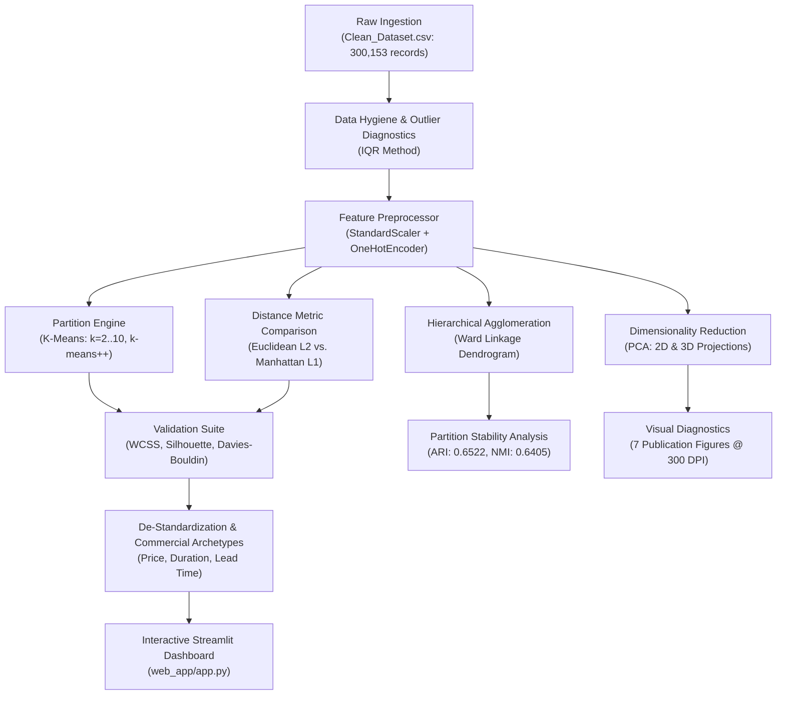

# Historical Airfare Route Profiles Through Regional Price Behaviour Clustering

[](LICENSE)
[](https://www.python.org/)
[](#)
[](#)
[](https://airfare-route-clustering.streamlit.app/)

An end-to-end, production-grade unsupervised learning system designed to discover regional airfare pricing behaviors and route profiles across domestic Indian aviation corridors without ground-truth labels.

---

## 1. Executive Overview & Academic Alignment

This project satisfies all requirements for **INT396 (Unsupervised Learning)** and University Problem Statement **SIH26056** at Lovely Professional University.

- **Student Name:** Pudi Sai Charan Teja
- **Registration Number:** 12507339
- **Roll Number:** RK3P24XCB35
- **Section:** K3P24XC
- **Project Type:** Individual Capstone Project (Sr. No. 26)
- **Course Outcomes Addressed:**
  - **CO2:** Apply partitioning methods (K-Means) and evaluate cluster cohesion across multiple $k$.
  - **CO3:** Implement agglomerative hierarchical clustering, linkage matrices, and compare geometric sensitivity under Euclidean vs. Manhattan norms.
  - **CO5:** Perform dimensionality reduction (PCA), eigen-decomposition, Scree analysis, and evaluate cluster boundaries in 2D/3D coordinate planes.

---

## 2. System Architecture & Pipeline Flowchart



---

## 3. Mathematical Foundations

### 3.1 Within-Cluster Sum of Squares (WCSS / Inertia)
Measures compactness of points within assigned cluster $C_k$ relative to centroid $\boldsymbol{\mu}_k$:
$$\text{WCSS} = \sum_{k=1}^K \sum_{\mathbf{x}_i \in C_k} \|\mathbf{x}_i - \boldsymbol{\mu}_k\|_2^2$$

### 3.2 Silhouette Coefficient
Evaluates balance between intra-cluster cohesion $a(i)$ and nearest-cluster separation $b(i)$:
$$s(i) = \frac{b(i) - a(i)}{\max(a(i), b(i))}, \quad S = \frac{1}{N}\sum_{i=1}^N s(i) \in [-1, 1]$$

### 3.3 Davies-Bouldin Index (DBI)
Measures the average similarity ratio between each cluster and its most similar counterpart (lower is better):
$$R_{ij} = \frac{s_i + s_j}{d(\boldsymbol{\mu}_i, \boldsymbol{\mu}_j)}, \quad \text{DBI} = \frac{1}{K}\sum_{i=1}^K \max_{j \neq i} R_{ij}$$

### 3.4 Principal Component Analysis (Covariance Eigendecomposition)
For standardized centered matrix $\mathbf{X} \in \mathbb{R}^{N \times D}$:
$$\boldsymbol{\Sigma} = \frac{1}{N-1}\mathbf{X}^T\mathbf{X}, \quad \boldsymbol{\Sigma}\mathbf{v}_m = \lambda_m \mathbf{v}_m$$
Where $\mathbf{v}_m$ represents orthogonal eigenvectors (principal components) and $\lambda_m$ represents explained variance eigenvalues.

---

## 4. Model Evaluation & Comparison Table

### 4.1 Hyperparameter Sweep ($k \in [2, 10]$)

| $k$ | WCSS (Inertia) | Silhouette Score | Davies-Bouldin Index | Assessment |
| :---: | :---: | :---: | :---: | :--- |
| 2 | 243,608.19 | 0.2079 | 1.7936 | Binary split (Economy vs. Business) |
| 3 | 215,854.88 | 0.1615 | 2.0268 | Transitional stage |
| **4 (Optimal)** | **196,078.81** | **0.1507** | **1.9156** | **Elbow inflection & distinct commercial archetypes** |
| 5 | 185,559.10 | 0.1404 | 2.0849 | Over-splitting of advance leisure sectors |
| 6 | 178,641.47 | 0.1209 | 2.1575 | Diminishing inertia gains |
| 8 | 168,457.42 | 0.1073 | 2.2245 | High fragmentation |
| 10 | 161,355.93 | 0.0954 | 2.4409 | Over-partitioned |

### 4.2 Distance Metric & Stability Benchmarks
- **Euclidean ($L_2$) Silhouette:** `0.1512` | Mean intra-cluster distance: `2.7377`
- **Manhattan ($L_1$) Silhouette:** `0.1555` | Mean intra-cluster distance: `7.4175`
- **Hierarchical (Ward) vs K-Means Concordance:**
  - Adjusted Rand Index (ARI): **0.6522**
  - Normalized Mutual Information (NMI): **0.6405**

---

## 5. Discovered Route Archetypes

| Cluster | Archetype Name | Mean Fare (INR) | Mean Flight Duration | Mean Lead Time | Operational Profile |
| :---: | :--- | :---: | :---: | :---: | :--- |
| **0** | **Standard Mid-Range Economy Corridor** | ₹9,053 | 7.95 Hours | 14.34 Days | Planned domestic business & personal travel. |
| **1** | **Long-Haul Multi-Stop Economy Route** | ₹8,654 | 22.45 Hours | 24.71 Days | Connecting itineraries bridging regional hubs. |
| **2** | **Advance Business Class Corridor** | ₹55,512 | 14.67 Hours | 25.76 Days | Premium full-service corporate travelers. |
| **3** | **Budget Advance-Booking Leisure Route** | ₹5,865 | 8.20 Hours | 38.13 Days | Price-sensitive early-bird leisure passengers. |

---

## 6. Directory Structure

```
.
├── data/
│   ├── raw/
│   │   └── Clean_Dataset.csv
│   └── processed/
│       └── clean_sample.csv
├── notebooks/
│   └── airfare_clustering_master.ipynb
├── src/
│   ├── __init__.py
│   ├── data_loader.py
│   ├── preprocessor.py
│   ├── clustering.py
│   ├── dimensionality.py
│   ├── metrics.py
│   ├── visualization.py
│   └── pipeline_runner.py
├── outputs/
│   ├── figures/
│   │   ├── 01_elbow_wcss_curve.png
│   │   ├── 02_silhouette_scores.png
│   │   ├── 03_davies_bouldin_index.png
│   │   ├── 04_hierarchical_dendrogram.png
│   │   ├── 05_pca_2d_clusters.png
│   │   ├── 06_pca_scree_plot.png
│   │   └── 07_cluster_centroids_profile.png
│   ├── models/
│   │   ├── preprocessor.joblib
│   │   ├── kmeans_optimal.joblib
│   │   └── pca_model.joblib
│   ├── clustering_metrics.csv
│   └── pipeline_results.json
├── web_app/
│   └── app.py
├── report/
│   └── Airfare_Route_Clustering_Report.md
├── presentation/
│   └── Airfare_Route_Clustering_Slides.md
├── PROJECT_LINKS.txt
├── requirements.txt
├── LICENSE
├── .gitignore
└── README.md
```

---

## 7. Setup & Execution Instructions

### 7.1 Clone and Setup Environment
```bash
# Clone the repository
git clone https://github.com/charanteja-pudi/airfare-route-clustering.git
cd airfare-route-clustering

# Create and activate virtual environment
python -m venv .venv
# Windows:
.venv\Scripts\activate
# Linux/macOS:
source .venv/bin/activate

# Install required dependencies
pip install -r requirements.txt
```

### 7.2 Run the End-to-End Pipeline
```bash
# Execute the entire training, evaluation, and figure generation workflow:
python -m src.pipeline_runner
```

### 7.3 Launch the Interactive Streamlit Dashboard
```bash
streamlit run web_app/app.py
```
Open your browser to `http://localhost:8501` to explore the interactive visualizers, $k$-tuning sliders, 3D PCA scatter plots, and live itinerary inference tool.

---

## 8. Author & Attribution

- **Author:** Pudi Sai Charan Teja
- **Registration Number:** 12507339
- **Course:** INT396 (Unsupervised Learning) - Lovely Professional University
- **License:** MIT License (see [LICENSE](LICENSE) for details)
