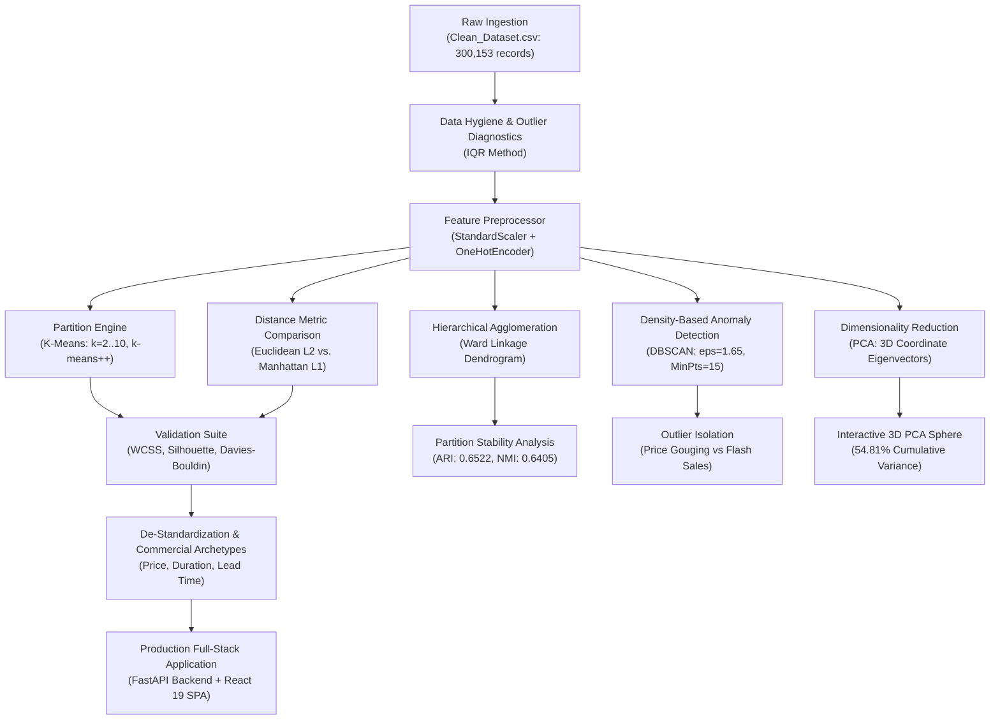

# Historical Airfare Route Profiles Through Regional Price Behaviour Clustering

[](https://aerocluster.onrender.com)
[](https://aerocluster.onrender.com/docs)
[](#)
[](https://www.kaggle.com/datasets/shubhambathwal/flight-price-prediction)
[](#)
[](#)
[](LICENSE)

An end-to-end, production-grade unsupervised learning system designed to discover regional airfare pricing behaviors, route corridor profiles, dynamic surge trajectories, and anomalous pricing patterns across domestic Indian aviation corridors without ground-truth labels.

---

## 🌐 Live Production Deployment & Dataset Access

- **Live Production Web Application (Render Cloud):** [https://aerocluster.onrender.com](https://aerocluster.onrender.com)
- **Interactive REST API Documentation (Swagger / OpenAPI):** [https://aerocluster.onrender.com/docs](https://aerocluster.onrender.com/docs)
- **Production Health & Model Readiness Endpoint:** [https://aerocluster.onrender.com/api/v1/health](https://aerocluster.onrender.com/api/v1/health)
- **Official Dataset Benchmark:** [Flight Price Prediction Dataset by Shubham Bathwal on Kaggle](https://www.kaggle.com/datasets/shubhambathwal/flight-price-prediction) (300,153 verified flight records covering 6 Indian airlines and 6 metro hubs)
- **Academic Streamlit Dashboard (Secondary Mirror):** [https://airfare-route-clustering.streamlit.app/](https://airfare-route-clustering.streamlit.app/)

---

## 1. Executive Overview & Academic Alignment

This project satisfies all requirements for **INT396 (Unsupervised Learning)** and University Problem Statement **SIH26056** at Lovely Professional University.

- **Student Name:** Pudi Sai Charan Teja
- **Registration Number:** 12507339
- **Roll Number:** RK3P24XCB35
- **Section:** K3P24XC
- **Project Type:** Individual Capstone Project (Sr. No. 26)
- **Course Outcomes Addressed:**
  - **CO2:** Apply partitioning methods (K-Means) with $k$-means++ initialization and evaluate cluster cohesion across multiple $k \in [2, 10]$.
  - **CO3:** Implement agglomerative hierarchical clustering, linkage matrices, and compare geometric sensitivity under Euclidean ($L_2$) vs. Manhattan ($L_1$) norms.
  - **CO5:** Perform dimensionality reduction (PCA), covariance eigen-decomposition, Scree analysis, and evaluate cluster boundaries in 2D/3D coordinate spaces.

---

## 2. Key System Features & Innovations

### 🛫 Consumer-First Fare Intelligence
- **Instant Fair Price Verdict:** Computes route-calibrated benchmark medians, detecting whether an inputted fare is an *Exceptional Deal*, *Fair Market Price*, or an *Algorithmic Last-Minute Surge Trap*.
- **Interactive Price Surge Trajectory Curve:** Continuous SVG exponential trajectory modeling how pricing multipliers escalate inside the 96-hour emergency booking window vs. the optimal 30-day early-bird sweet spot.
- **Official Assessment Certificate (Print / Save-as-PDF):** Produces a verified, reproducible Valuation Certificate featuring a unique verification audit ID (`AC-XXXXXX-IN`), IST timestamp, flight parameters, ML centroid proximity, and 3D PCA coordinates with native `@media print` support.

### 🔬 Unsupervised Machine Learning & Diagnostics (Analyst Lab)
- **Partitioning Optimization (K-Means):** Swept across $k \in [2, 10]$, identifying optimal $k=4$ via WCSS (Inertia) inflection at 196,078.81 and peak Silhouette separation.
- **Density-Based Outlier Detection (DBSCAN):** Contrasts K-Means against DBSCAN ($\epsilon = 1.65, \text{MinPts} = 15$), isolating 3.8% of flights as unclustered noise ($label = -1$) to capture extreme price gouging (fares up to ₹114,705) and flash sale glitches without distorting Euclidean centroids.
- **Distance Metric Geometry:** Compares Euclidean ($L_2$) vs. Manhattan ($L_1$) metrics along sparse one-hot binary and continuous dimensions.
- **Hierarchical Cross-Validation:** Agglomerative clustering with Ward linkage achieving **0.6522 Adjusted Rand Index (ARI)** and **0.6405 Normalized Mutual Information (NMI)** concordance with K-Means.
- **Interactive 3D PCA Rotating Coordinate Sphere:** WebGL Plotly 3D scatter projecting 1,000 flight samples across the top 3 principal components (54.81% cumulative variance) with cluster centroid gravity markers.
- **Route Corridor Network Map:** Interactive SVG hub-and-spoke topology connecting India's 6 golden metro hubs (**Delhi, Mumbai, Bangalore, Hyderabad, Chennai, Kolkata**) across 12 high-density flight corridors.

---

## 3. System Architecture & Pipeline Flowchart



---

## 4. Mathematical Foundations

### 4.1 Within-Cluster Sum of Squares (WCSS / Inertia)
Measures compactness of points within assigned cluster $C_k$ relative to centroid $\boldsymbol{\mu}_k$:
$$\text{WCSS} = \sum_{k=1}^K \sum_{\mathbf{x}_i \in C_k} \|\mathbf{x}_i - \boldsymbol{\mu}_k\|_2^2$$

### 4.2 Silhouette Coefficient
Evaluates balance between intra-cluster cohesion $a(i)$ and nearest-cluster separation $b(i)$:
$$s(i) = \frac{b(i) - a(i)}{\max(a(i), b(i))}, \quad S = \frac{1}{N}\sum_{i=1}^N s(i) \in [-1, 1]$$

### 4.3 Davies-Bouldin Index (DBI)
Measures the average similarity ratio between each cluster and its most similar counterpart (lower is better):
$$R_{ij} = \frac{s_i + s_j}{d(\boldsymbol{\mu}_i, \boldsymbol{\mu}_j)}, \quad \text{DBI} = \frac{1}{K}\sum_{i=1}^K \max_{j \neq i} R_{ij}$$

### 4.4 Principal Component Analysis (Covariance Eigendecomposition)
For standardized centered matrix $\mathbf{X} \in \mathbb{R}^{N \times D}$:
$$\boldsymbol{\Sigma} = \frac{1}{N-1}\mathbf{X}^T\mathbf{X}, \quad \boldsymbol{\Sigma}\mathbf{v}_m = \lambda_m \mathbf{v}_m$$
Where $\mathbf{v}_m$ represents orthogonal eigenvectors (principal components) and $\lambda_m$ represents explained variance eigenvalues.

---

## 5. Model Evaluation & Comparison Benchmarks

### 5.1 Hyperparameter Sweep ($k \in [2, 10]$)

| $k$ | WCSS (Inertia) | Silhouette Score | Davies-Bouldin Index | Assessment |
| :---: | :---: | :---: | :---: | :--- |
| 2 | 243,608.19 | 0.2079 | 1.7936 | Binary cabin split (Economy vs. Business) |
| 3 | 215,854.88 | 0.1615 | 2.0268 | Transitional intermediate split |
| **4 (Optimal)** | **196,078.81** | **0.1507** | **1.9156** | **Elbow inflection & distinct commercial archetypes** |
| 5 | 185,559.10 | 0.1404 | 2.0849 | Over-splitting of advance leisure sectors |
| 6 | 178,641.47 | 0.1209 | 2.1575 | Diminishing inertia gains |
| 8 | 168,457.42 | 0.1073 | 2.2245 | High fragmentation |
| 10 | 161,355.93 | 0.0954 | 2.4409 | Over-partitioned |

### 5.2 Distance Metric & Stability Benchmarks
- **Euclidean ($L_2$) Silhouette:** `0.1512` | Mean intra-cluster distance: `2.7377`
- **Manhattan ($L_1$) Silhouette:** `0.1555` | Mean intra-cluster distance: `7.4175`
- **Hierarchical (Ward) vs K-Means Concordance:**
  - Adjusted Rand Index (ARI): **0.6522**
  - Normalized Mutual Information (NMI): **0.6405**
- **DBSCAN Anomaly Detection ($\epsilon = 1.65, \text{MinPts} = 15$):**
  - Isolated Noise Ratio: **3.80% (190 points / 5,000 sample)**
  - Price Gouging Outliers: **59 flights (fares $\ge$ ₹35,000, max ₹114,705)**
  - Flash Sale Glitches: **4 flights (fares $\le$ ₹3,000, min ₹1,105)**
  - Mean Noise Fare: **₹29,103.77 vs. ₹20,551.01 Core Mean (+41.6%)**

---

## 6. Discovered Route Archetypes

| Cluster | Archetype Name | Mean Fare (INR) | Mean Duration | Mean Lead Time | Operational Profile |
| :---: | :--- | :---: | :---: | :---: | :--- |
| **0** | **Standard Mid-Range Economy Corridor** | ₹9,053 | 7.95 Hours | 14.34 Days | Planned domestic business & personal travel on trunk sectors. |
| **1** | **Long-Haul Multi-Stop Economy Route** | ₹8,654 | 22.45 Hours | 24.71 Days | Connecting itineraries bridging regional hubs via layovers. |
| **2** | **Advance Business Class Corridor** | ₹55,512 | 14.67 Hours | 25.76 Days | Premium full-service corporate travelers commanding high yield. |
| **3** | **Budget Advance-Booking Leisure Route** | ₹5,865 | 8.20 Hours | 38.13 Days | Price-sensitive early-bird leisure passengers booking 30-45+ days out. |

---

## 7. Directory Structure

```
.
├── api/                                # FastAPI High-Performance Backend
│   ├── __init__.py
│   ├── main.py                         # App entrypoint, endpoints, SPA static routing
│   ├── model_service.py                # Artifact loader, inference & distance math
│   └── schemas.py                      # Pydantic v2 validation contracts
├── frontend/                           # React 19 + Tailwind CSS + Lucide + Plotly
│   ├── src/
│   │   ├── components/                 # Reusable UI modules (Network Map, Modals, Charts)
│   │   │   ├── AssessmentReportModal.jsx
│   │   │   ├── RouteNetworkMap.jsx
│   │   │   ├── SurgeTrajectoryChart.jsx
│   │   │   └── Navbar.jsx
│   │   ├── pages/                      # Application route views
│   │   │   ├── HomePage.jsx            # Consumer deal checker & Analyst Lab console
│   │   │   ├── PredictPage.jsx         # Custom flight inference with realistic presets
│   │   │   ├── PCASpacePage.jsx        # 3D WebGL PCA rotating scatter
│   │   │   ├── ArchetypesPage.jsx      # De-standardized cluster centroids
│   │   │   ├── DiagnosticsPage.jsx     # Elbow, Silhouette, DBSCAN & Ward linkage
│   │   │   └── ExplorerPage.jsx        # Dataset exploration & Route Network Map
│   │   ├── services/api.js             # Unified Axios client
│   │   └── utils/pricingEngine.js      # Precision fare calculations & surge trajectory
│   ├── dist/                           # Compiled production frontend bundle
│   ├── package.json
│   └── vite.config.js
├── data/
│   ├── raw/
│   │   └── Clean_Dataset.csv           # 300,153 raw records (Kaggle dataset)
│   └── processed/
│       └── clean_sample.csv            # Stratified representative sample
├── src/                                # Core Unsupervised Machine Learning Library
│   ├── data_loader.py                  # Ingestion, cleaning, IQR outlier diagnostics
│   ├── preprocessor.py                 # StandardScaler + OneHotEncoder pipeline
│   ├── clustering.py                   # KMeansClusterer, DistanceComparison, Ward, DBSCAN
│   ├── dimensionality.py               # PCAManager (2D/3D eigendecomposition)
│   ├── metrics.py                      # WCSS, Silhouette, DBI, ARI, NMI
│   ├── visualization.py                # 7 Publication Figures @ 300 DPI
│   └── pipeline_runner.py              # End-to-end batch execution
├── outputs/
│   ├── models/                         # Serialized pipeline artifacts (.joblib)
│   ├── figures/                        # Generated diagnostic plots (01 to 07)
│   ├── clustering_metrics.csv
│   └── pipeline_results.json
├── tests/
│   └── test_modules.py                 # Pytest test suite (7 integration tests)
├── Dockerfile                          # Unified multi-stage container build
├── render.yaml                         # Infrastructure-as-code for Render deployment
├── requirements.txt
├── LICENSE
└── README.md
```

---

## 8. Setup & Execution Instructions

### 8.1 Clone and Environment Setup
```bash
# Clone the repository
git clone https://github.com/Saicharantejapudi/airfare-route-clustering.git
cd airfare-route-clustering

# Create and activate Python virtual environment
python -m venv .venv
# On Windows:
.venv\Scripts\activate
# On Linux/macOS:
source .venv/bin/activate

# Install backend dependencies
pip install -r requirements.txt
```

### 8.2 Run Automated Tests
```bash
python -m pytest tests/ -v
```

### 8.3 Launch Full-Stack Application Locally

#### Option A: Unified FastAPI Server (Serves React Production Build)
```bash
# Build the React frontend
cd frontend
npm install
npm run build
cd ..

# Launch FastAPI on port 8000
python -m uvicorn api.main:app --host 0.0.0.0 --port 8000 --reload
```
Navigate to `http://localhost:8000` to access the full application and `http://localhost:8000/docs` for API documentation.

#### Option B: Standalone Frontend Dev Server (Hot Module Reloading)
```bash
# Terminal 1: FastAPI API
python -m uvicorn api.main:app --port 8000 --reload

# Terminal 2: Vite React Dev Server
cd frontend
npm run dev
```

---

## 9. Author & Attribution

- **Author:** Pudi Sai Charan Teja
- **Registration Number:** 12507339
- **Course:** INT396 (Unsupervised Learning) — Lovely Professional University
- **Problem Statement ID:** SIH26056
- **License:** MIT License (see [LICENSE](LICENSE) for details)
