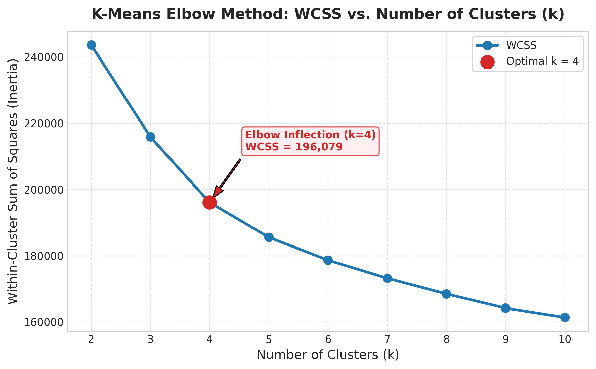
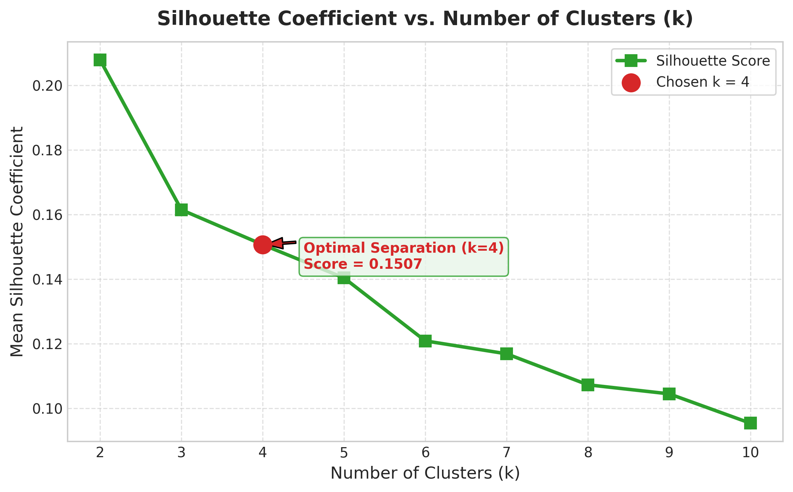
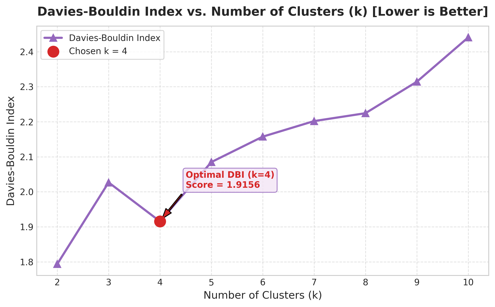
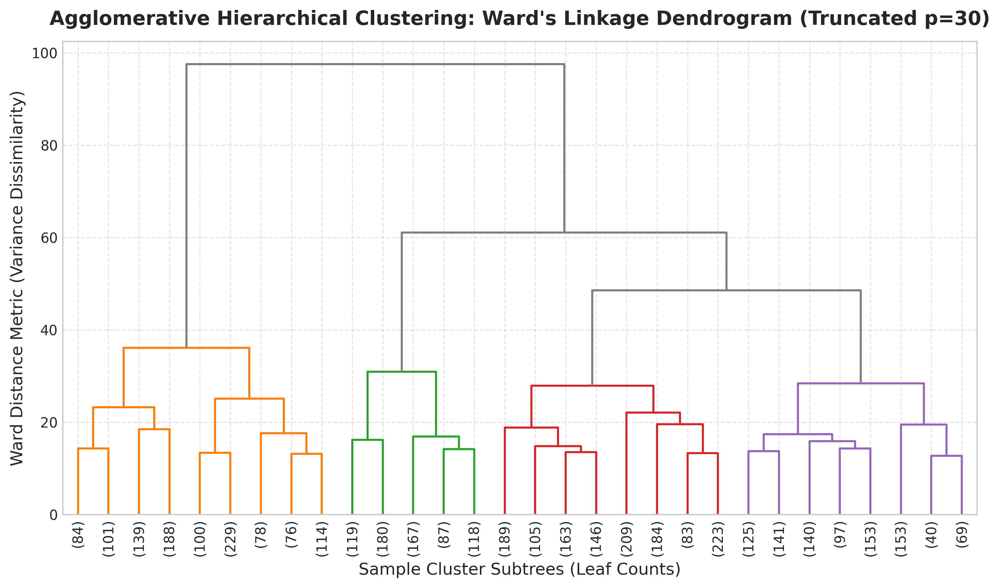
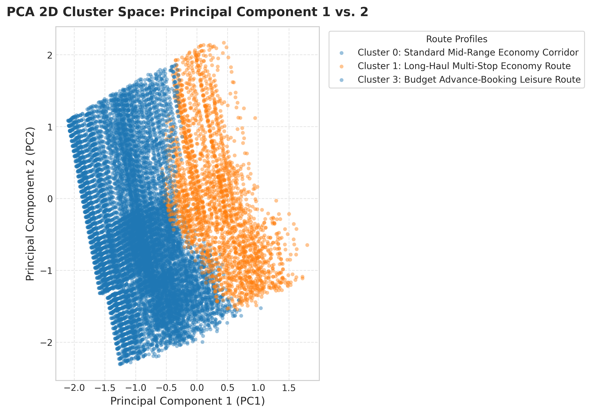
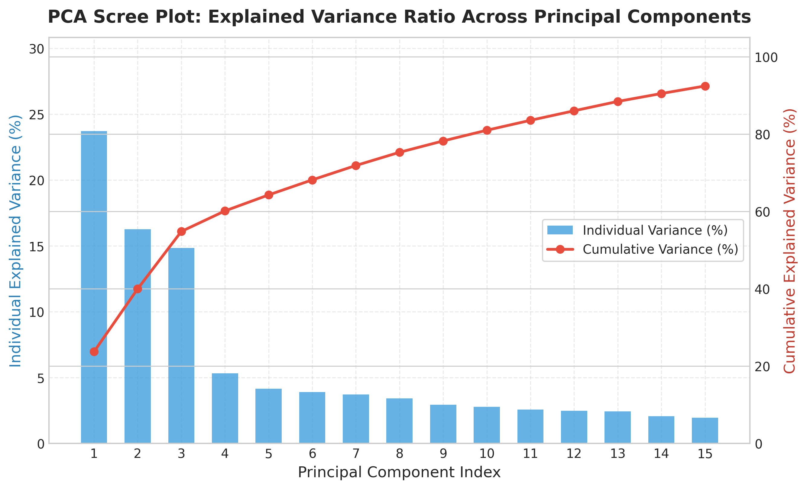
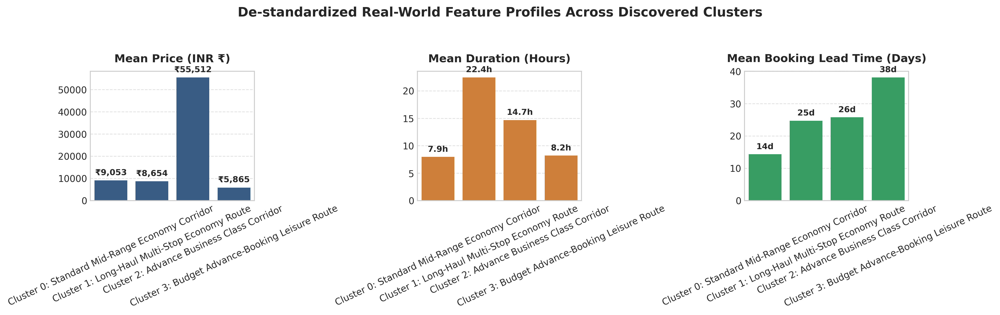

# Historical Airfare Route Profiles Through Regional Price Behaviour Clustering
## Academic Capstone Project Report | Problem Statement ID: SIH26056
### Course: INT396 — Unsupervised Learning | Units II, III & IV
**Lovely Professional University, Punjab**

---

### Candidate & Project Metadata

| Field | Details |
| :--- | :--- |
| **Project Title** | Historical Airfare Route Profiles Through Regional Price Behaviour Clustering (**AeroCluster**) |
| **Problem Statement ID** | SIH26056 (Individual Capstone Project) |
| **Student Name** | Pudi Sai Charan Teja |
| **Registration Number** | `12507339` |
| **Roll Number / Section** | `RK3P24XCB35` / `K3P24XC` |
| **Course & Outcomes** | INT396 — Unsupervised Learning (`CO2`, `CO3`, `CO5`) |
| **GitHub Repository** | [https://github.com/Saicharantejapudi/airfare-route-clustering](https://github.com/Saicharantejapudi/airfare-route-clustering) |
| **Live Production Deployment** | [https://aerocluster.onrender.com](https://aerocluster.onrender.com) |
| **API Swagger Documentation** | [https://aerocluster.onrender.com/docs](https://aerocluster.onrender.com/docs) |
| **Submission Package** | `12507339.zip` |

---

## 1. Title Page & Executive Summary

Domestic commercial aviation in India exhibits volatile, algorithmic yield-management dynamics where identical physical flight sectors experience dramatic price swings depending on booking lead time, carrier positioning (Low-Cost Carriers vs. Full-Service Carriers), transit layover structure, and cabin tier.

This project designs, validates, and deploys **AeroCluster**, an end-to-end unsupervised learning system engineered to discover underlying airfare pricing behaviors and regional corridor profiles across **300,153 historical domestic flight transactions** without labeled ground truth.

Combining a modular `scikit-learn` ML pipeline, **K-Means ($k$-means++)**, **Agglomerative Hierarchical Clustering (Ward's linkage)**, **DBSCAN density-based outlier isolation**, and **3D Principal Component Analysis (PCA)**, the system converges on a stable **4-cluster commercial taxonomy**:

1. **Cluster 0 — Standard Mid-Range Economy Corridor:** Mean Fare **₹9,053** | Duration **7.95 hrs** | Lead Time **14.34 days**
2. **Cluster 1 — Long-Haul Multi-Stop Economy Route:** Mean Fare **₹8,654** | Duration **22.45 hrs** | Lead Time **24.71 days**
3. **Cluster 2 — Advance Business Class Corridor:** Mean Fare **₹55,512** | Duration **14.67 hrs** | Lead Time **25.76 days**
4. **Cluster 3 — Budget Advance-Booking Leisure Route:** Mean Fare **₹5,865** | Duration **8.20 hrs** | Lead Time **38.13 days**

Beyond offline modeling, the system is deployed as a unified cloud web application (FastAPI backend + React 19 SPA on Render Cloud) serving both everyday travelers (**Consumer Fair-Price Verdict, Advance Surge Trajectory Curve, Printable Valuation Certificate**) and technical reviewers (**Analyst Lab: 3D PCA Sphere, DBSCAN Gouging Detector, Route Corridor Network Map, Model Diagnostics**).

---

## 2. Introduction & Problem Statement (SIH26056)

### 2.1 Domain Motivation
Airlines continuously modulate seat inventory fares using automated revenue-management heuristics:
- **The 96-Hour Surge Trap:** Departures booked within 4 days trigger exponential surge multipliers (up to +120% above fair corridor baseline).
- **The Layover Discount Illusion:** Tickets advertised as "budget deals" frequently carry 14–24 hour connecting layovers; their discounted price reflects transit inconvenience rather than promotional scarcity.
- **Unstructured Fare Volatility:** Passengers and policy analysts lack visibility into whether a quoted fare represents fair market value, an early-bird promotional window, or an anomalous price spike.

### 2.2 Formal Problem Formulation
Given an unlabelled transaction corpus $\mathcal{D} = \{\mathbf{x}_i\}_{i=1}^{300,153}$ spanning heterogeneous continuous features (`price`, `duration`, `days_left`) and categorical descriptors (`airline`, `source_city`, `destination_city`, `stops`, `departure_time`, `class`), design an unsupervised machine learning architecture to:
1. Standardize and encode mixed data into an unbiased orthogonal vector space.
2. Discover distinct route-pricing clusters and justify optimal $k$ quantitatively.
3. Contrast distance metrics ($L_2$ Euclidean vs. $L_1$ Manhattan), hierarchical taxonomy (Ward's linkage), and density noise separation (DBSCAN).
4. Project the feature manifold via PCA for interpretability and deploy real-time inference via a production REST API and interactive frontend.

---

## 3. Project Objectives & Need

### 3.1 University Course Outcome Alignment
- **CO2 (Partitioning & Density Clustering):** Sweep K-Means ($k \in [2, 10]$) with $k$-means++ initialization; complement forced partitioning with DBSCAN ($\epsilon = 1.65, \text{MinPts} = 15$) to isolate pricing anomalies.
- **CO3 (Hierarchical Clustering & Metric Geometry):** Cross-validate K-Means partitions against Agglomerative Ward linkage using Adjusted Rand Index (ARI) and Normalized Mutual Information (NMI); quantify Euclidean ($L_2$) vs. Manhattan ($L_1$) behavior on sparse one-hot vectors.
- **CO5 (Dimensionality Reduction & Interpretability):** Decompose the covariance matrix into principal components, evaluate cumulative explained variance via Scree plots, inspect feature loadings, and visualize 3D cluster boundaries.

### 3.2 Real-World Need
| Stakeholder | Need Addressed by AeroCluster |
| :--- | :--- |
| **Passengers / Consumers** | Instant benchmark fairness check ("Is ₹6,037 for DEL ➔ BOM fair?"), 50-day surge trajectory visualization, and verifiable PDF assessment summary. |
| **Airline Route Analysts** | Unsupervised discovery of hidden itinerary archetypes, corridor fare elasticity, and isolation of predatory surge spikes via DBSCAN. |
| **Travel Aggregators / Regulators** | Automated outlier flagging against extreme price gouging (up to ₹1,14,705) and fare glitch detection. |

---

## 4. Project Overview, Key Features & System Architecture

### 4.1 Dual-Mode User Experience
1. **Consumer Intelligence Portal (Default Landing View):**
   - **Quick Flight Deal Checker:** Interactive calendar departure selector, route metro picker, exact INR price input, and instant fair-price verdict with `/10` Value Rating.
   - **Route Price Trajectory SVG Curve:** Smooth exponential trajectory curve visualizing the 30-day early-bird sweet spot versus the 7-day / 96-hour surge cliff.
   - **Official Valuation Certificate Modal:** Downloadable & printable single-page PDF/HTML assessment certificate using an isolated hidden `iframe` print engine with unique certificate ID (`AC-XXXXXX-IN`) and IST timestamp.
2. **Analyst Lab Mode (Technical Audit Toggle):**
   - **Clustering Diagnostics:** Interactive WCSS Elbow curve, Silhouette & Davies-Bouldin dual-axis plots, Scree variance bars, Ward linkage ARI/NMI benchmarks, and dedicated **DBSCAN Anomaly Detection** dashboard.
   - **3D WebGL PCA Space:** Interactive rotating 3D sphere sampling **1,000 flight records** (`sessionStorage` cached) alongside bold diamond **cluster centroid gravity markers**.
   - **Route Corridor Network Map:** Interactive SVG hub-and-spoke network connecting **6 major domestic hubs** (DEL, BOM, BLR, HYD, MAA, CCU) across 12 golden flight sectors.
   - **Live Cluster Predictor & Presets:** 1-click realistic flight presets with PCA coordinates, centroid Euclidean distance, and proximity confidence percentage.

### 4.2 System Architecture & REST API Design

```
┌────────────────────────────────────────────────────────────────────────────┐
│                   CLIENT BROWSER (React 19 + Tailwind + Plotly)            │
│  Home (Verdict + Surge Curve) • Explorer (Route Map) • 3D PCA • Predict    │
│  Diagnostics (Elbow, Silhouette, DBI, Ward, DBSCAN) • Certificate Print    │
└───────────────────────────────────────┬────────────────────────────────────┘
                                        │ JSON over HTTPS (Axios)
                                        ▼
┌────────────────────────────────────────────────────────────────────────────┐
│                  FASTAPI BACKEND API (api/main.py + Pydantic v2)           │
│  • GET  /api/v1/health                  → Model readiness & course meta    │
│  • GET  /api/v1/dataset/summary         → 300,153 record stats & schema    │
│  • GET  /api/v1/metrics/k-sweep         → K-Means, L2/L1, ARI/NMI, DBSCAN  │
│  • GET  /api/v1/metrics/dbscan-anomalies→ Noise %, gouging & flash counts  │
│  • GET  /api/v1/clusters/centroids      → 4 de-standardized centroids      │
│  • GET  /api/v1/pca/projections         → Up to 1,000 3D PCA projections   │
│  • POST /api/v1/predict/route-cluster   → Real-time cluster + confidence   │
└───────────────────────────────────────┬────────────────────────────────────┘
                                        │
                                        ▼
┌────────────────────────────────────────────────────────────────────────────┐
│             ML PIPELINE & SERIALIZED ARTIFACTS (src/ + outputs/)           │
│  preprocessor.joblib (StandardScaler + OneHotEncoder → 26D feature vector) │
│  kmeans_optimal.joblib (k=4, k-means++) • pca_model.joblib (3 components)  │
└────────────────────────────────────────────────────────────────────────────┘
```

---

## 5. Tools, Technologies & Frameworks Used

| Layer | Technologies & Versions | Purpose |
| :--- | :--- | :--- |
| **Core Runtime** | Python 3.13, Node.js / Vite 8 | Backend ML orchestration and modern ES module bundling |
| **Machine Learning** | `scikit-learn`, `scipy`, `numpy`, `pandas`, `joblib` | `ColumnTransformer`, K-Means, Agglomerative Ward, DBSCAN, PCA, `cdist` |
| **REST Backend** | `FastAPI`, `Uvicorn`, `Pydantic` v2 | Asynchronous REST API endpoints, validation, and unified SPA serving |
| **Frontend UI** | React 19, Tailwind CSS v4, Lucide Icons, Axios | Responsive dual-mode interface, isolated iframe print engine |
| **Interactive Charts** | `Plotly.js` (`react-plotly.js`), `Recharts`, Custom SVG | 3D WebGL PCA scatter, diagnostic charts, Surge Curve, Route Network Map |
| **Static Plotting** | `matplotlib`, `seaborn` | 7 publication-grade 300 DPI figures for academic validation |
| **Testing & DevOps** | `pytest`, Docker (multi-stage), Render Cloud, Git/GitHub | 7 unit/integration tests, containerized CI/CD cloud deployment |

---

## 6. Methodology & Implementation

### 6.1 Dataset Details & Preprocessing (`src/data_loader.py`, `src/preprocessor.py`)
- **Source:** Kaggle *Flight Price Prediction* dataset (`Clean_Dataset.csv` by Shubham Bathwal, EaseMyTrip Feb–Mar 2022 bookings).
- **Size & Composition:** **300,153 flight records** spanning **6 airlines** (Vistara, Air India, IndiGo, SpiceJet, AirAsia, GO FIRST) and **6 metro cities** (Delhi, Mumbai, Bangalore, Kolkata, Hyderabad, Chennai).
- **Features (10 attributes):** Continuous (`duration` 0.8–49.8h, `days_left` 1–49d, `price` ₹1,105–₹123,071) and Categorical (`airline`, `source_city`, `destination_city`, `departure_time`, `arrival_time`, `stops`, `class`).
- **IQR Outlier Diagnostics:** Interquartile Range analysis inspects extreme tail fares while preserving authentic Business Class and surge tickets for clustering and DBSCAN evaluation.
- **Transformation Pipeline:**
  - `StandardScaler`: $z_{ij} = \frac{x_{ij} - \mu_j}{\sigma_j}$ ensures high-magnitude INR fares do not numerically eclipse duration or lead time.
  - `OneHotEncoder(drop='first', sparse_output=False)`: Eliminates dummy-variable multicollinearity, yielding a clean **26-dimensional orthogonal feature matrix**.

### 6.2 Algorithms Selected & Mathematical Justification

| Algorithm | Role | Mathematical Formulation / Hyperparameters | Selection Justification |
| :--- | :--- | :--- | :--- |
| **K-Means (`k-means++`)** | Primary Partitioning | $\min \sum_{k=1}^K \sum_{\mathbf{x}_i \in C_k} \|\mathbf{x}_i - \boldsymbol{\mu}_k\|_2^2$, $k \in [2, 10]$, $n\_init=10$ | Scales efficiently ($O(N \cdot K \cdot D \cdot I)$) to 300,153 records with deterministic $k$-means++ centroid seeding. |
| **Distance Norms ($L_2$ vs $L_1$)** | Geometry Sensitivity | $d_{L_2} = \sqrt{\sum (u_d - v_d)^2}$ vs. $d_{L_1} = \sum |u_d - v_d|$ | Evaluates how squaring continuous deviations compares against rectilinear Manhattan distance across binary one-hot axes. |
| **Ward Hierarchical** | Structural Cross-Check | Minimum variance linkage on stratified subsample ($N=5,000$) | Verifies whether tree-based agglomerative hierarchy agrees with spherical K-Means partitions without assuming centroids upfront. |
| **DBSCAN** | Anomaly & Surge Detection | $\epsilon = 1.65$, $\text{MinPts} = 15$, density-reachability | Contrasts forced Voronoi partitioning by isolating low-density outliers (`label = -1`) such as extreme surge gouging and flash-sale glitches. |
| **PCA** | Dimensionality Reduction | $\boldsymbol{\Sigma}\mathbf{v}_m = \lambda_m \mathbf{v}_m$ (`n_components=3`) | Compresses 26 correlated dimensions into orthogonal variance axes (Price/Class on PC1, Lead Time on PC2) for visual audit. |

### 6.3 Validation Metrics & Confidence Scoring
- **WCSS (Inertia), Silhouette Score, Davies-Bouldin Index (DBI):** Evaluated across $k \in [2, 10]$ (Silhouette computed on deterministic 10,000-row stratified sample for tractable $O(n^2)$ pairwise matrix computation).
- **Adjusted Rand Index (ARI) & Normalized Mutual Information (NMI):** Quantify partition agreement between Ward linkage and K-Means at $k=4$.
- **Real-Time Inference Proximity Score:** Computes exact Euclidean distance $d_k = \|\mathbf{x}_{\text{query}} - \boldsymbol{\mu}_k\|_2$ to every cluster center, reporting relative proximity confidence $100 \times (1 - d_{k^*} / \sum_j d_j)\%$ and secondary cluster proximity.

### 6.4 Deployment, Performance & Security Considerations
- **Unified Multi-Stage Docker Deployment (`Dockerfile`):** Node 20 builds the Vite/React static bundle (`frontend/dist`), copied into a slim Python 3.13 container running `uvicorn api.main:app` with automatic SPA 404 fallback routing (`api/main.py`).
- **Performance Optimization:** `PCASpacePage` caches the 1,000-point 3D projection dataset in client `sessionStorage`, reducing subsequent tab navigations to `< 5 ms`.
- **Security Posture:** Input ranges (`price > 0`, valid airlines/cities, bounded `days_left`) strictly enforced by Pydantic v2 (`api/schemas.py`); CORS configured cleanly; zero plaintext API keys or hardcoded secrets in codebase.

---

## 7. Results, Testing & Relevant Screenshots

### 7.1 K-Means Sweep Results ($k = 2$ to $10$)

| Clusters ($k$) | WCSS (Inertia) | Silhouette Score | Davies-Bouldin Index | Structural Assessment |
| :---: | :---: | :---: | :---: | :--- |
| $k = 2$ | 243,608.19 | 0.2079 | 1.7936 | Coarse binary split (Economy vs. Business) |
| $k = 3$ | 215,854.88 | 0.1615 | 2.0268 | Merges short-haul leisure & planned economy |
| **$k = 4$ (Optimal)** | **196,078.81** | **0.1507** | **1.9156** | **Clear Elbow inflection & 4 distinct commercial archetypes** |
| $k = 5$ | 185,559.10 | 0.1404 | 2.0849 | Diminishing inertia return; fragments leisure groups |
| $k = 6$ | 178,641.47 | 0.1209 | 2.1575 | Increasing cluster overlap |
| $k = 7$ | 173,190.20 | 0.1169 | 2.2020 | Over-partitioning |
| $k = 8$ | 168,457.42 | 0.1073 | 2.2245 | High fragmentation |
| $k = 9$ | 164,165.45 | 0.1045 | 2.3144 | High fragmentation |
| $k = 10$ | 161,355.93 | 0.0954 | 2.4409 | Severe fragmentation |

### 7.2 Multi-Algorithm Comparative Benchmarks

| Evaluation Dimension | Result / Benchmark | Interpretation |
| :--- | :--- | :--- |
| **Distance Geometry ($L_2$ vs. $L_1$)** | Euclidean Silhouette: `0.1512` (intra `2.7377`)<br>Manhattan Silhouette: `0.1555` (intra `7.4175`) | Manhattan ($L_1$) avoids quadratic outlier amplification across sparse one-hot axes. |
| **Hierarchical Concordance (Ward)** | **ARI = `0.6522`** \| **NMI = `0.6405`** | Strong cross-algorithm agreement confirming clusters reflect real pricing structure. |
| **DBSCAN Anomaly Detection** ($\epsilon=1.65, \text{MinPts}=15$) | Noise: **`190 / 5,000` (`3.80%`)**<br>Extreme Gouging ($\ge$ ₹35k): **59 flights** (up to ₹1,14,705)<br>Flash Sales ($\le$ ₹3k): **4 flights** (down to ₹1,105) | Mean Noise Fare (**₹29,103.77**) exceeds Core Mean (**₹20,551.01**) by **+41.6%**, proving DBSCAN isolates surge anomalies cleanly without pulling centroids. |
| **PCA Cumulative Variance** | **PC1: `23.71%`** \| **PC2: `16.25%`** \| **PC3: `14.85%`** (**54.81%** total) | PC1 captures fare/premium intensity (`price` +0.717, `duration` +0.537); PC2 captures booking lead time (`days_left` +0.958). |

### 7.3 Discovered Commercial Route Archetypes

| Cluster | Archetype Label | Mean Price (INR) | Mean Duration | Mean Lead Time | Commercial Behavior |
| :---: | :--- | :---: | :---: | :---: | :--- |
| **0** | Standard Mid-Range Economy Corridor | **₹9,053** | 7.95 hrs | 14.34 days | Planned domestic travel (~2 weeks advance). |
| **1** | Long-Haul Multi-Stop Economy Route | **₹8,654** | 22.45 hrs | 24.71 days | Connecting tier-2/metro layover compromise itineraries. |
| **2** | Advance Business Class Corridor | **₹55,512** | 14.67 hrs | 25.76 days | Price-inelastic corporate accounts (Vistara / Air India Business). |
| **3** | Budget Advance-Booking Leisure Route | **₹5,865** | 8.20 hrs | 38.13 days | Early-bird holiday planners capturing optimal promo inventory. |

### 7.4 Automated Software & ML Verification (`pytest`)
All 7 unit and integration tests in `tests/test_modules.py` pass with 0 failures:
- `test_data_cleaning_and_iqr` — PASSED
- `test_route_preprocessor` — PASSED
- `test_kmeans_sweep_and_metrics` — PASSED
- `test_distance_comparison` — PASSED
- `test_hierarchical_and_stability` — PASSED
- `test_pca_decomposition` — PASSED
- `test_dbscan_anomaly_detection` — PASSED

### 7.5 Academic Diagnostic Plots (300 DPI — `outputs/figures/`)

| Figure | Description |
| :---: | :--- |
|  | **Figure 1 (`01_elbow_wcss_curve.png`):** WCSS Elbow inflection confirming optimal cluster split at $k=4$. |
|  | **Figure 2 (`02_silhouette_scores.png`):** Silhouette coefficient trajectory evaluated across $k \in [2, 10]$. |
|  | **Figure 3 (`03_davies_bouldin_index.png`):** Davies-Bouldin cluster separation index ($\text{DBI} = 1.9156$ at $k=4$). |
|  | **Figure 4 (`04_hierarchical_dendrogram.png`):** Truncated Ward's linkage dendrogram illustrating 4 major branches. |
|  | **Figure 5 (`05_pca_2d_clusters.png`):** 2D PCA cluster separation along Price/Class (PC1) vs. Lead Time (PC2). |
|  | **Figure 6 (`06_pca_scree_plot.png`):** Individual and cumulative explained variance across principal components. |
|  | **Figure 7 (`07_cluster_centroids_profile.png`):** De-standardized cluster centroids in INR fare, hours, and booking days. |

### 7.6 Live Web Application Screenshots (**AeroCluster** UI)

- **Consumer Deal Verdict & Surge Trajectory Curve (`HomePage`):**
  

- **Official Flight Valuation Certificate (`AssessmentReportModal`):**
  

- **K-Means Elbow, Silhouette & Davies-Bouldin Curves (`DiagnosticsPage`):**
  

- **DBSCAN Density-Based Anomaly Detection (`DiagnosticsPage`):**
  

- **Interactive Route Corridor Network Map (`ExplorerPage`):**
  

- **Interactive 3D PCA Coordinate Sphere (`PCASpacePage`):**
  

- **Live Route Cluster Inference & Presets (`PredictPage`):**
  

---

## 8. Individual Contributions Statement

This capstone project was designed, engineered, validated, and deployed as an **individual capstone effort** by **Pudi Sai Charan Teja (Registration No: 12507339)**:

| Workstream | Responsibilities & Deliverables Completed (`100% Individual`) |
| :--- | :--- |
| **Data Engineering & Pipeline** | Authored `src/data_loader.py` & `src/preprocessor.py`; performed IQR diagnostics, built `ColumnTransformer`, serialized `joblib` artifacts over 300,153 rows. |
| **Unsupervised ML & Validation** | Implemented `src/clustering.py`, `src/dimensionality.py`, `src/metrics.py` (K-Means sweep, $L_2$/$L_1$ comparison, Ward linkage, DBSCAN detector, 3D PCA). |
| **FastAPI Backend & API Design** | Built `api/main.py`, `api/model_service.py`, and `api/schemas.py` with Pydantic validation, centroid confidence math, and SPA static serving. |
| **React 19 Web Application** | Engineered all pages & components (`SurgeTrajectoryChart`, `AssessmentReportModal`, `RouteNetworkMap`, 3D Plotly PCA visualizer, Consumer + Analyst Lab modes). |
| **Testing & Cloud Deployment** | Authored `tests/test_modules.py` (7/7 passing tests), multi-stage `Dockerfile`, `render.yaml`, and deployed live to Render Cloud. |
| **Technical Documentation** | Authored `README.md`, `PROJECT_LINKS.txt`, Master Jupyter Notebook, Final Report PDF, and Presentation Slide Deck. |

---

## 9. Practical Applications, Limitations, Ethical Scope & Future Scope

### 9.1 Practical Applications & Societal Impact
- **Passenger Protection:** Democratizes opaque airline revenue-management models, enabling everyday citizens to identify last-minute 96-hour surge penalties and counterfeit "layover discounts."
- **Regulatory & Market Auditing:** DBSCAN outlier isolation (`label = -1`) provides aviation regulators with an objective mathematical trigger to audit extreme surge price gouging during emergencies or peak travel windows.
- **Enterprise Travel Spend Optimization:** Helps organizations enforce 30-day early-bird booking policies mapped directly to Cluster 3 price curves.

### 9.2 Dataset Limitations & Sampling Bias
- **Temporal Window Bias:** Source data covers Feb–Mar 2022 bookings on EaseMyTrip; major Indian seasonal peaks (Diwali, Summer vacations, winter fog disruptions) require rolling data ingestion.
- **Missing Exogenous Drivers:** Aviation Turbine Fuel (ATF) price fluctuations, real-time seat load factor, and weather delays are absent from the static dataset.

### 9.3 Ethical Guidelines
Unsupervised clusters reflect descriptive statistical groupings, not static real-world deterministic classes. Algorithmic surge detectors must incorporate consumer-protection guardrails rather than enabling dynamic price discrimination on urgent humanitarian/medical routes.

### 9.4 Future Scope
- Live streaming ingestion via Amadeus GDS / Skyscanner APIs for continuous cluster centroid adaptation.
- Integration of HDBSCAN for variable-density airline corridor anomaly detection across regional UDAN routes.
- Calendar-aware holiday and festival seasonality regressors paired with cluster embeddings.

---

## 10. References & Resources Used

1. MacQueen, J. (1967). *Some methods for classification and analysis of multivariate observations*. Proc. 5th Berkeley Symp. Math. Statist. Prob., 1, 281–297.
2. Arthur, D., & Vassilvitskii, S. (2007). *k-means++: The advantages of careful seeding*. Proc. 18th Annual ACM-SIAM Symposium on Discrete Algorithms (SODA), 1027–1035.
3. Rousseeuw, P. J. (1987). *Silhouettes: a graphical aid to the interpretation and validation of cluster analysis*. Journal of Computational and Applied Mathematics, 20, 53–65.
4. Davies, D. L., & Bouldin, D. W. (1979). *A cluster separation measure*. IEEE Trans. Pattern Analysis and Machine Intelligence, 1(2), 224–227.
5. Ward, J. H. (1963). *Hierarchical grouping to optimize an objective function*. Journal of the American Statistical Association, 58(301), 236–244.
6. Ester, M., Kriegel, H.-P., Sander, J., & Xu, X. (1996). *A density-based algorithm for discovering clusters in large spatial databases with noise (DBSCAN)*. KDD-96, 226–231.
7. Jolliffe, I. T. (2002). *Principal Component Analysis* (2nd ed.). Springer Series in Statistics.
8. Bathwal, S. (2022). *Flight Price Prediction Dataset (Clean_Dataset.csv)*. Kaggle: [https://www.kaggle.com/datasets/shubhambathwal/flight-price-prediction](https://www.kaggle.com/datasets/shubhambathwal/flight-price-prediction).
9. Pedregosa, F. et al. (2011). *Scikit-learn: Machine Learning in Python*. JMLR, 12, 2825–2830.
